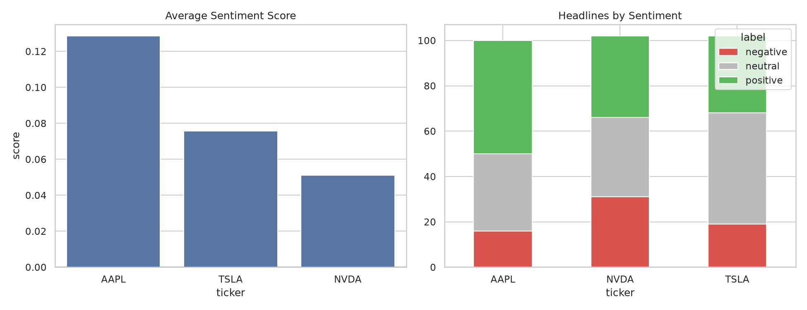

# Exploratory Data Analysis of Financial News Sentiment

Scraping financial news headlines and visualizing sentiment scores for AAPL, TSLA, and NVDA.

## Objective
- Obtain financial news as text
- Visualize sentiment scores of selected companies

## Tools
Python, BeautifulSoup, NLTK (VADER), pandas, matplotlib, seaborn

## Method
1. Scraped ~300 headlines (about 100 per company) from Google News RSS
2. Scored each headline with VADER, extended with a custom financial lexicon
3. Visualized average sentiment and label distribution per company

## Results

- AAPL had the highest average sentiment (~0.12), followed by TSLA (~0.08) and NVDA (~0.06)
- NVDA had the largest share of negative headlines (~30%)

## Limitations
- VADER's general-purpose lexicon misreads some financial headlines, so I added custom financial words
- Small sample from a single source and a short time window
- Differences between companies are small and not statistically tested

## Future Work
- Replace VADER with FinBERT (a finance-trained model)
- Collect data over a longer period and from multiple sources

## Files
- `Untitled.ipynb`: the full analysis notebook
- `financial_news_sentiment.csv`: scraped headlines with sentiment scores
- `sentiment_overview.png`: results chart
