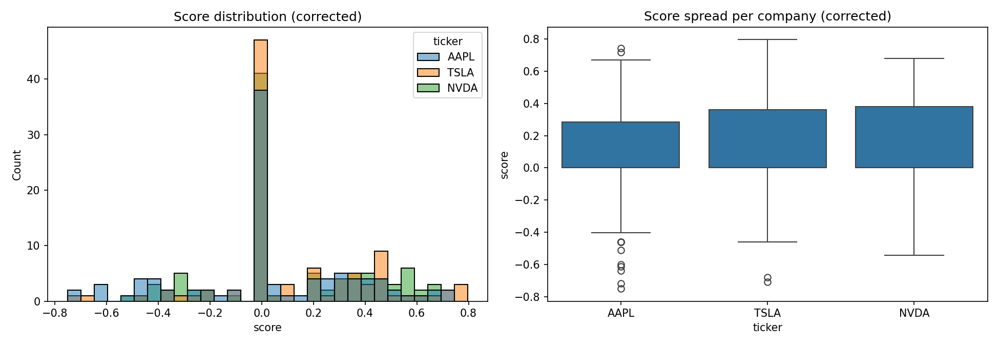

 # Exploratory Data Analysis of Financial News Sentiment

An exploratory analysis of the tone of English-language financial news headlines about Apple (AAPL), NVIDIA (NVDA) and Tesla (TSLA). It combines data cleaning, descriptive statistics, uncertainty estimates, sensitivity checks, and a manual evaluation of how well VADER agrees with human labels.

> **Scope:** this measures the wording of news *headlines*, as scored by a lexicon-based model. It is not investor sentiment and it says nothing about stock returns or investment decisions.



## Questions explored

| Question | Short answer |
|---|---|
| How are scores distributed? | 38-47% of headlines score exactly 0 (see Finding 2); the rest spread across both directions |
| How do companies compare? | NVDA and TSLA have higher means than AAPL, but no test found a reliable difference (Findings 4 and 5) |
| How does sentiment change over time? | Coverage is too uneven to say: 60% of headlines fall on two days (Finding 3) |
| Is headline length related to the score? | No meaningful linear relationship (\|r\| < 0.05) |
| Does a small finance lexicon help VADER? | No reliable improvement: 2 more correct headlines out of 101 (Finding 6) |

## Data

- **Source:** Google News RSS searches ("<company> stock").
- **Date range:** 1 September - 27 October 2026.
- **Size:** 302 scraped headlines, 296 after removing 6 exact-title duplicates.
- **Snapshot:** each scrape returns different headlines, so every number in this README comes from the committed `financial_news_sentiment_clean.csv`. Re-running the collection will give a different dataset.

| | AAPL | NVDA | TSLA |
|---|---|---|---|
| Headlines | 99 | 98 | 99 |
| First headline | 2026-09-01 | 2026-10-06 | 2026-09-30 |
| Last headline | 2026-10-27 | 2026-10-27 | 2026-10-27 |

### Fields in `financial_news_sentiment_clean.csv`

| Field | Description |
|---|---|
| ticker | AAPL, NVDA or TSLA |
| date | Publication time parsed from the RSS feed |
| headline | Original headline, including the publisher suffix |
| headline_clean | Headline with the trailing publisher name removed |
| score | VADER compound score on `headline_clean`, using the extended finance lexicon (used for all results) |
| label | positive (score >= 0.05), negative (score <= -0.05), otherwise neutral |
| headline_length | Number of words in the headline |
| day | Calendar date used for daily grouping |
| raw_default | Default VADER score on the original headline |
| clean_default | Default VADER score on the cleaned headline |
| score_raw | Score from the original pipeline, before publisher names were removed |

## Workflow

1. **Collect:** Google News RSS results per company with `requests` and BeautifulSoup.
2. **Clean:** parse dates, remove exact duplicate headlines, count words, remove the trailing publisher name (e.g. "- Yahoo Finance").
3. **Score:** NLTK VADER compound score. Compared the default lexicon with one extended by 24 hand-picked finance terms.
4. **Explore:** distributions, boxplots, daily counts, word frequencies, descriptive statistics per company.
5. **Compare cautiously:** bootstrap confidence intervals (5,000 resamples) in a common date window, Kruskal-Wallis test, and six sensitivity scenarios.
6. **Evaluate:** compared VADER with manual labels on a random sample (34 headlines per company), using accuracy, per-class precision/recall/F1, macro-F1 and confusion matrices.

## Key findings

### 1. Publisher names distorted the scores
Headlines end with the publisher's name, and VADER scored it as text. In VADER's default lexicon, "fool" has a score of -1.9, and 25 headlines came from The Motley Fool. Removing publisher names changed **26 of 296 scores** (AAPL 7, NVDA 9, TSLA 10). All results below use the corrected scores.

### 2. Descriptive statistics (corrected scores)

| | AAPL | NVDA | TSLA |
|---|---|---|---|
| n | 99 | 98 | 99 |
| Mean | 0.046 | 0.114 | 0.126 |
| Median | 0 | 0 | 0 |
| Std | 0.329 | 0.298 | 0.288 |
| Q1 / Q3 | 0 / 0.285 | 0 / 0.382 | 0 / 0.361 |
| IQR | 0.285 | 0.382 | 0.361 |
| % scored exactly 0 | 38.4 | 41.8 | 47.5 |

The median is 0 for all three companies, so the means come from the non-zero headlines. A score of 0 does not necessarily mean the headline is neutral: it can mean the model did not pick up the tone (see Finding 6).

### 3. Coverage is uneven in time
- 178 of 296 headlines (60%) are dated 26-27 October.
- From 13 to 25 October no company had more than 9 headlines per day.
- AAPL starts on 1 Sep, TSLA on 30 Sep and NVDA on 6 Oct, so averages over the full period are not comparable across companies.

### 4. No reliable difference between companies
Common window (from 6 Oct, 276 headlines). Bootstrap 95% confidence interval for the mean:

| | n | Mean | 95% CI |
|---|---|---|---|
| AAPL | 85 | 0.034 | [-0.036, 0.103] |
| NVDA | 98 | 0.114 | [0.056, 0.174] |
| TSLA | 93 | 0.129 | [0.067, 0.187] |

Kruskal-Wallis across the three companies: p = 0.173 (p = 0.266 on all headlines). The intervals overlap and no test found a difference. This does not show the companies are equivalent; it means this sample gives no strong evidence of a difference. The intervals treat headlines as independent, which is probably too optimistic (see Limitations).

### 5. Sensitivity checks

| Scenario | n (AAPL / NVDA / TSLA) | Mean (AAPL / NVDA / TSLA) | KW p |
|---|---|---|---|
| All headlines | 99 / 98 / 99 | 0.046 / 0.114 / 0.126 | 0.266 |
| Common window (from 6 Oct) | 85 / 98 / 93 | 0.034 / 0.114 / 0.129 | 0.173 |
| No duplicated text across headlines | 80 / 85 / 87 | 0.046 / 0.123 / 0.133 | 0.223 |
| Excluding 26-27 Oct | 56 / 32 / 30 | 0.125 / 0.006 / 0.041 | 0.133 |
| Non-zero scores only* | 61 / 57 / 52 | 0.074 / 0.195 / 0.240 | 0.062 |
| \|score\| >= 0.3 only* | 36 / 39 / 33 | 0.055 / 0.277 / 0.326 | 0.072 |

\*These two scenarios filter on the score itself, so treat them as exploratory.

- In none of the six scenarios did the test detect a difference (p between 0.062 and 0.266).
- The company ordering is not stable: AAPL has the lowest mean in five scenarios and the highest when 26-27 Oct are excluded (small samples).
- 44 headlines share identical text with another headline (for example, one article mentioning two companies).
- The scenarios overlap heavily, and p-values are not corrected for multiple comparisons.

### 6. VADER versus manual labels
A random sample of 102 headlines was labeled positive, negative or neutral without seeing the model's scores. One was left unlabeled, so n = 101 (55 positive, 24 neutral, 22 negative by hand).

| Model | Correct / 101 | Accuracy | Macro-F1 |
|---|---|---|---|
| VADER default, cleaned text | 42 | 0.416 | 0.423 |
| VADER + finance lexicon, cleaned text | 44 | 0.436 | 0.431 |
| VADER + finance lexicon, raw text (original pipeline) | 40 | 0.396 | 0.385 |
| Always predict "positive" (baseline) | 55 | 0.545 | n/a |

Per class, VADER + lexicon on cleaned text:

| Class | Precision | Recall | F1 |
|---|---|---|---|
| Negative | 0.529 | 0.409 | 0.462 |
| Neutral | 0.239 | 0.458 | 0.314 |
| Positive | 0.632 | 0.436 | 0.516 |

- VADER agrees with the manual labels on only about 4 in 10 headlines, **below the always-positive baseline**.
- The main error is scoring positive headlines as neutral: the model predicted neutral for 46 headlines versus 24 labeled neutral by hand, and 26 of the 55 headlines labeled positive were scored neutral. The "neutral" share of the automated labels is therefore likely overstated.
- The finance lexicon gained 2 correct headlines over the default (44 vs 42), and removing publisher names gained 4 (44 vs 40). Both differences are within noise at n = 101. The lexicon terms were chosen after reading headlines from the same scrape, so this check is not independent.

### 7. Frequent words
After removing publisher names and company names, frequent terms included SpaceX, merger, iPhone, Barclays and Musk, next to generic words such as "after", "says" and "will".

## Conclusion
In this sample, headline scores for AAPL, NVDA and TSLA are small on average, and 38-47% of them are exactly zero. No test detected a difference between the companies, and the company ordering changed across sensitivity checks. A manual check showed that VADER matches the human labels on only about 42-44% of headlines and often scores positive headlines as neutral. So the differences between companies are not reliable, and the measurement itself is weak. These results are exploratory and should not be read as trading signals.

## Limitations
- Short, uneven time window; 60% of headlines fall on two days.
- Headlines are not independent (shared text, same events), so confidence intervals and p-values are probably too optimistic.
- Manual labels come from a single annotator on 101 headlines (22 negative, 24 neutral), so per-class metrics are unstable. The labels also skew positive (54%).
- The finance lexicon is small, hand-specified and was not validated on independent data.
- Single source (Google News RSS); VADER is a general-purpose lexicon model.
- Headline scores describe wording only; they are not a measure of market movement or investors' opinions.

## Running the project

Install the packages:

```bash
pip install pandas numpy requests beautifulsoup4 lxml nltk matplotlib seaborn scipy scikit-learn jupyter
```

1. Open `eda_sentiment_analysis.ipynb` and run the cells in order. The collection cells query the live Google News RSS feed, so a re-run produces a different dataset and different numbers.
2. To reproduce the numbers in this README, use the committed `financial_news_sentiment_clean.csv` and `manual_labeled.csv` instead of re-scraping. In `manual_labeled.csv`, `id` is the row index of the clean CSV, so the labels only match that exact file.
3. Open `vader_evaluation.ipynb` to reproduce the manual-label evaluation. Labels use `p` (positive), `n` (negative) and `u` (neutral).

## Tools
Python, pandas, NumPy, requests, BeautifulSoup, NLTK (VADER), Matplotlib, Seaborn, SciPy, scikit-learn, Jupyter

## Repository files
- `eda_sentiment_analysis.ipynb`: collection, cleaning, EDA, statistics and sensitivity checks
- `vader_evaluation.ipynb`: comparison of VADER with the manual labels
- `financial_news_sentiment_clean.csv`: cleaned dataset with corrected scores
- `manual_labeled.csv`: manual labels for the 102 sampled headlines (one left blank)
- `eda_overview_corrected.png`: score distribution and spread per company

## Next steps
- Label a larger set with more than one annotator and measure agreement.
- Review the disagreements between manual labels and VADER predictions.
- Test a finance-specific model such as FinBERT on the same labeled sample (it could not be downloaded in the hosted environment used here).
- Collect data over a longer period and from several sources, deduplicating by story.
- Add confidence intervals for the classification metrics.

*Disclaimer: this is an exploratory data-analysis project. Its scores should not be used as financial or investment advice.*
